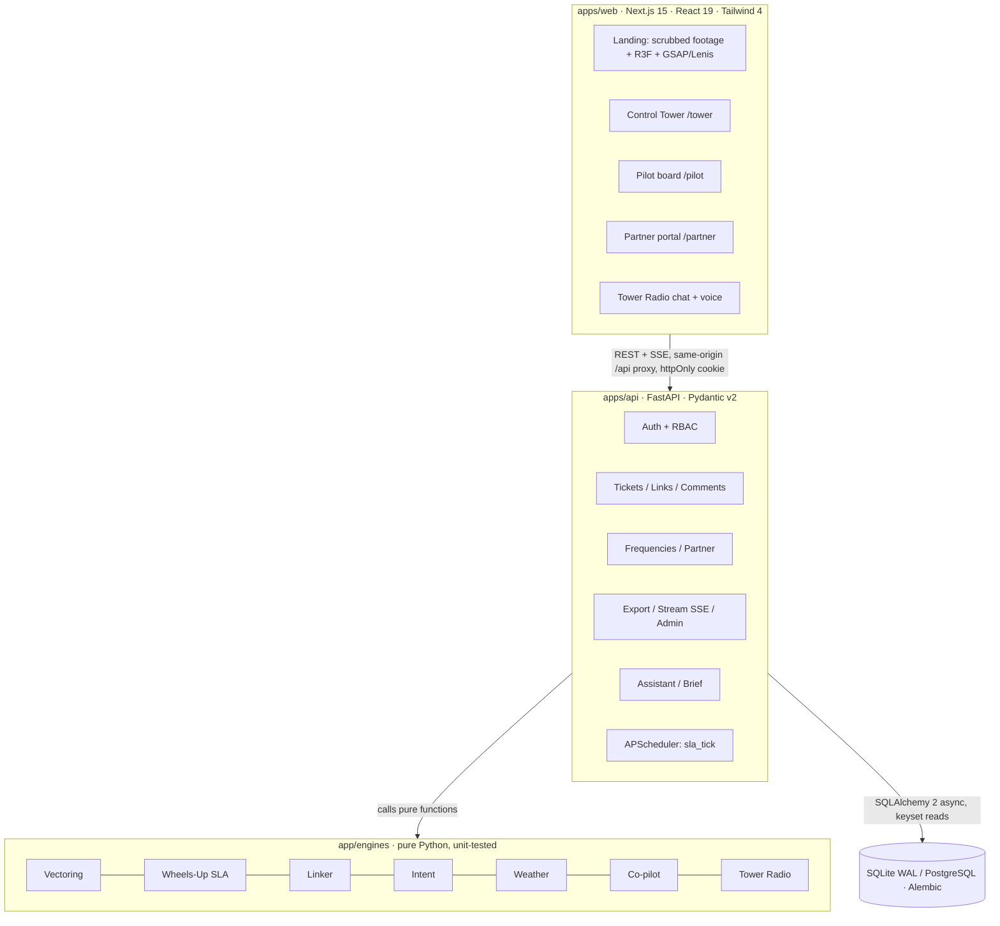

<div align="center">

# ✈ OpsDesk Control Tower

### Every ticket is a *flight*.

**A travel-operations ticketing platform for TBO's B2B world, built as an air-traffic control tower.**
Linked cases, explainable routing, SLAs that count down to the guest's check-in, side conversations that survive a handoff,
an insight loop from conversations, and uncapped exports, with a voice assistant and a partner portal on top.

`Python 3.12` · `FastAPI` · `SQLAlchemy 2` · `scikit-learn` · `Next.js 15` · `React 19` · `Tailwind 4` · `GSAP` · `Lenis` · `React Three Fiber`

**[▶ Watch the 4-minute demo video](https://drive.google.com/drive/folders/1E1uyaZgydQRglXeVXrytohNdNHtkvjsT?usp=sharing)** · [Pitch deck (PDF)](docs/presentation/OpsDesk_Idea_Submission.pdf)

Built by **Team Outliers** (Swayam Panchal · Jeevesh Bodhani · Rishit Lahoti · Shreyas Kale), Dept. of AI & Data Science, DJSCE

</div>

---

## Demo video and pitch deck

| | |
| --- | --- |
| 🎬 **Demo video** (4:11, 1080p, narrated with captions) | [Watch on Google Drive](https://drive.google.com/drive/folders/1E1uyaZgydQRglXeVXrytohNdNHtkvjsT?usp=sharing): the problem, the solution, every persona live in the app, the architecture, the tech stack and the impact |
| 📊 **Pitch deck** | [PDF](docs/presentation/OpsDesk_Idea_Submission.pdf) · [PPTX](docs/presentation/OpsDesk_Idea_Submission.pptx) (generated by `docs/presentation/build_deck.js`) |
| 🛠 **How the video is made** | `docs/video/`: `scenes.mjs` holds the script, `build.mjs` generates the voiceover (edge-tts) and the animated composition, and `render.mjs` renders it frame by frame with Playwright and ffmpeg. Screens come from `e2e/capture-video-shots.mjs` against the running app. |

---

## Contents

1. [What OpsDesk is](#1-what-opsdesk-is)
2. [Quick start (three commands)](#2-quick-start-three-commands)
3. [Demo accounts and personas](#3-demo-accounts-and-personas)
4. [Feature checklist: Problems 1 to 6](#4-feature-checklist-problems-1-to-6)
5. [Signature features](#5-signature-features)
6. [How the engines work](#6-how-the-engines-work)
7. [Architecture](#7-architecture)
8. [Data model](#8-data-model)
9. [API reference](#9-api-reference)
10. [Frontend, design system and landing page](#10-frontend-design-system-and-landing-page)
11. [First-time users: onboarding, demo and live data](#11-first-time-users-onboarding-demo-and-live-data)
12. [Security](#12-security)
13. [Testing](#13-testing)
14. [Scale path and retention stance](#14-scale-path-and-retention-stance)
15. [Media, data and licences](#15-media-data-and-licences)
16. [Commands](#16-commands)
17. [Project layout](#17-project-layout)
18. [Status: done, stubbed and next](#18-status-done-stubbed-and-next)

---

## 1. What OpsDesk is

TBO's current ticketing tool treats every agency contact as an isolated task. The same refund raised three times becomes three
unrelated tickets; routing is FIFO; side conversations break when a ticket moves; SLAs ignore when the guest actually travels;
insights stay trapped in threads; exports stop at about 3,000 rows.

OpsDesk fixes that with one metaphor that is also the product, the brand and the UI:

| Ticketing term | Control Tower term | Meaning in the product |
| --- | --- | --- |
| Ticket | **Flight** | One case, with a callsign such as `OD-24817` |
| Agency | **Airport** | The requester's origin, with a churn-risk *turbulence* meter |
| TBOH booking | **Flight path** | The booking every related flight shares |
| Linked tickets | **Constellation** | Related cases drawn as a connected graph |
| Routing | **Vectoring** | Assigning a flight to a controller, with a reason |
| Agent | **Controller** | Works the queue |
| Escalation manager | **Tower Chief** | Receives escalations directly |
| Lead | **Airport Director** | Queue health, SLA risk, insights, exports |
| Requester | **Pilot** | Agency user tracking their own flights |
| Supplier contact | **Supplier Partner** | External organisation answering side conversations |
| SLA | **Wheels-up clock** | Time left, shrinking as check-in or LCD nears |
| Side conversation | **Frequency** | A radio channel with explicit recipients |
| Insights | **Weather radar** | Themes and spikes from conversations |
| Export and archive | **Black box and hangar** | Large extracts and retention |

Every technical term in the app has a **plain-language hint** (dotted underline, hover or focus), so non-technical users
understand the screen without training.

---

## 2. Quick start (three commands)

**Prerequisites:** Python 3.12 with [`uv`](https://docs.astral.sh/uv/), Node 20+ with `pnpm` 9, and `ffmpeg` (only for `make media`).

```bash
make setup
```

```bash
make seed
```

```bash
make dev
```

| URL | What |
| --- | --- |
| http://localhost:3000 | Landing page (scroll story) |
| http://localhost:3000/login | "Choose your callsign" (one-click demo personas) |
| http://localhost:8000/docs | OpenAPI docs for the API |

`make setup` copies `.env.example` to `.env`. No secrets are required: a random JWT secret is generated on first run into
`apps/api/.secrets/` (gitignored). SQLite runs in WAL mode by default; set `DATABASE_URL` to a `postgresql+asyncpg://` URL to use
PostgreSQL (`docker compose up -d postgres` gives you one).

> Seed data is generated **relative to now** (check-in in 9 hours, ghost flight in 36 hours), so run `make seed` shortly before a demo.
> `make seed` empties and refills the tables in place, so the running API keeps working; no restart needed.
>
> **Fastest demo:** open http://localhost:3000 and press **Take the 90-second flight**: the Demo Autopilot signs in as the
> Airport Director and narrates every feature.

---

## 3. Demo accounts and personas

> Each persona has a step-by-step guide in [`docs/personas`](docs/personas/README.md).

All demo users share the demo-only password **`cleared-for-takeoff`** (from `DEMO_PASSWORD`, used only by the seed script). On
`/login`, click a callsign card to sign in instantly.

| Persona | Role key | Email | Region | Home screen | Primary needs |
| --- | --- | --- | --- | --- | --- |
| **Pilot** (agency requester) | `requester` | `pilot.saf@opsdesk.demo` | India (Saffron Trails, Mumbai) | `/pilot` departures board | Status of own flights, never repeat an explanation |
| **Controller** (ops agent) | `agent` | `priya.nair@opsdesk.demo` | India | `/tower` | History, linked cases, routing reason, clean supplier threads |
| **Tower Chief** (escalation manager) | `escalation_manager` | `rahul.kapoor@opsdesk.demo` | All | `/tower/escalations` | Direct escalations, check-in and LCD urgency |
| **Airport Director** (ops lead) | `lead` | `meera.iyer@opsdesk.demo` | All | `/tower` | Queue health, SLA risk, presets, Chaos Mode, exports |
| **Supplier Partner** (external org) | `supplier` | `partner.atlas@opsdesk.demo` | UAE (Atlas Bedbank) | `/partner` | Answer TBO's side conversations, track response time |

More seeded accounts: every agency has `pilot.<code>@` and `ops.<code>@` (12 agencies, codes `SAF MON KON DUN GHT MCT TGT PEN HRS
LCV ADB BTK`), two controllers per region (`priya.nair`, `arjun.mehta`, `omar.haddad`, `layla.farouk`, `james.whitlock`,
`sophie.clarke`, `wei.lim`, `ananya.rao`), two Tower Chiefs (`rahul.kapoor`, `fatima.alzahra`) and two supplier partners
(`partner.atlas`, `partner.crescent`). All names and companies are fictional.

### Demo journeys

| Journey | Proves | Script |
| --- | --- | --- |
| **A. Context and linkage** | Problem 1 | Sign in as the Pilot, file "Refund for TBOH-88213 still not received". The intent suggests *Refund > Delay*, the booking panel shows 2 earlier cases, and the new flight links both, fires the **Third-Contact Guardian** (priority raised) and writes created, intent, linked, guardian, SLA and routed events. |
| **B. Routing** | Problem 2 | Sign in as `pilot.dun@` (Dubai) and file a P1. It is vectored to the UAE controller **Omar (AE-01)** with "Region match UAE (+40), P1 urgency (+30), on shift (+15)…" and runner-ups explaining why others lost. |
| **C. Side conversation** | Problem 3 | As Priya open the TBOH-66120 flight. It has a Frequency with two suppliers and Finance Desk. Transfer to Omar: the **HandoffDiff** shows who stays, joins and drops; suppliers stay locked; the timeline records the check. |
| **D. SLA and escalate** | Problem 4 | The TBOH-90009 flight checks in within 9 hours and is at risk, turning critical within minutes. Escalate with a reason: owner and queue change and it lands in the Tower Chief's queue within a second. |
| **E. Insights and data** | Problems 5, 6 | `GET /api/insights/themes` shows themes with week-over-week change and an emerging *Inventory sync* spike. As the Director, `GET /api/export/tickets?format=csv` streams every row with no cap (60,000 with `make seed-big`). |
| **G. Storm** | Chaos | As the Director press **Chaos mode** (or `make chaos`): 40 overbooking flights from many agencies arrive live over SSE. |

---

## 4. Feature checklist: Problems 1 to 6

| # | Problem today | What OpsDesk ships | Where |
| --- | --- | --- | --- |
| **1** | Tickets without context | ✅ Auto-linking by **TBOH** (1.0), **agency + intent within 30 days** (0.8) and **TF-IDF text similarity** (0.5-0.7) with link reason and strength · ✅ **Intent classifier** (TF-IDF + logistic regression + override rules, top-3 with confidence, "needs a human" below 0.55) · ✅ **Third-Contact Guardian** · ✅ append-only **timeline** · ✅ booking panel "You have 2 earlier cases" | `engines/linker.py`, `engines/intent.py`, `/tower/t/[id]`, `/pilot` |
| **2** | Hardcoded FIFO/LIFO routing | ✅ **Vectoring** across region, shift window, priority and agency rank, availability, skill and load · ✅ four presets · ✅ every decision stored with a score breakdown, one-line reason and "why not" runner-ups · ✅ assign, unassign, reassign, auto-route · ✅ triage, my queue and escalation views | `engines/vectoring.py`, `routing_decisions`, ScoreWaterfall |
| **3** | Side-conversation recipients break on transfer | ✅ **Frequencies** with explicit, lockable recipients independent of the ticket group · ✅ **HandoffDiff** requires confirmation on transfer · ✅ internal notes and external replies are separate routes, permissions and colours · ✅ **Supplier Partner portal** so the other organisation replies inside OpsDesk | `routers/frequencies.py`, `routers/partner.py`, `/partner` |
| **4** | One-size SLA, escalation by email | ✅ **Wheels-up clock** from priority, check-in and LCD (holiday pause supported) · ✅ ok / at risk / critical / breached with a fuel gauge · ✅ first-class **Escalate** (reason required) that changes owner and queue · ✅ `sla_tick` job every minute pushes state changes over SSE · ✅ escalation proposed when critical near check-in | `engines/wheels_up.py`, `jobs/sla_tick.py`, FuelGauge |
| **5** | Insights trapped, AI costs extra | ✅ Lexicon theme tagging, weekly counts, week-over-week change, z-score **emerging** flag, sample tickets · ✅ **Co-pilot Brief** (rule-based, no paid AI) · ✅ **Tower Radio** assistant and voice, free (browser speech) | `engines/weather.py`, `engines/copilot.py`, `engines/assistant.py` |
| **6** | 3K-row exports, no realtime, archive tax | ✅ Durable SQLite WAL / Postgres · ✅ **streaming CSV and NDJSON** with keyset pagination, no cap · ✅ **SSE** feed · ✅ retention job `archive-run` · ✅ documented scale path | `routers/export.py`, `routers/stream.py`, `jobs/archive.py` |

**MVP-7 Roles and access** ✅: five roles in one place (`core/rbac.py`). Requesters see only their agency (cross-agency reads return
**404**), suppliers see only their channels, agents cannot use lead routes. All tested.

---

## 5. Signature features

| Feature | What it does |
| --- | --- |
| 🛫 **Flight Strips** | Every queue row is an ATC strip: callsign, agency, TBOH, intent chip, check-in countdown and a fuel bar on the edge. `J`/`K` to move, `Enter` to open, `E` to escalate. |
| ⛽ **Wheels-up fuel gauge** | SVG arc whose length is remaining SLA; colour follows state, pulses when critical, counts down live. |
| 🧭 **Vectoring explainer** | Score waterfall plus "why not Priya?" runner-ups for every routing decision. |
| 🔁 **Third-Contact Guardian** | Same agency and intent (or TBOH) 3+ times in 14 days: links, bumps priority, alerts the Tower Chief, shows a contact-fatigue banner. |
| 📻 **Frequency lock and handoff check** | Recipient chips are locked to the Frequency; transfers show a diff modal that needs confirmation. |
| 🪞 **Agency mirror** | One toggle shows exactly what the Pilot sees, using the same serializer, so an internal note can never leak. |
| ✨ **Co-pilot Brief** | One click: linked history, agency mood, clock, supplier status, next best action and a reply draft, with a *why* on every line. |
| 🎙 **Tower Radio** | Persona-aware chatbot and push-to-talk voice assistant. Ask "what should I work on first?", "show breached flights in UAE", "find OD-24817", "how is routing decided?". It answers from live data, shows flight cards and speaks the reply using the most natural voice on the device. |
| 🤝 **Supplier Partner portal** | External suppliers see only their channels, reply with quick templates, and see their median response time. Replies land on the ticket timeline live. |
| 🌪 **Chaos Mode** | The Director injects 40 overbooking flights from many agencies to show live routing and SSE. |
| 🧑‍✈️ **First-flight onboarding** | Welcome flow: pick demo airspace or live tower, a role checklist, then a guided 30-second tour. Replay any time. |
| 🔀 **Demo / Live airspace** | Each user switches between 3,000 seeded flights and only real flights from the top bar. |
| ⌘ **Command palette** | `⌘K`: jump to a callsign or TBOH, switch screens, toggle the radar ping. |
| 📡 **Tower calls** | Live toasts with the callsign first (`OD-24817 ESCALATED > TOWER CHIEF`), with an optional synthesised radar ping. |

### 5b. Proactive operations (features nobody else will think of)

Built from research into how TBO works with other organisations: ~159k agencies in 100+ countries, hotel suppliers,
bedbanks and DMCs, channel partners such as HyperGuest, rate-intelligence partners such as RateGain, and HR systems such as
**Darwinbox** (named in the problem statement) whose leave and shift data never reaches the helpdesk today.

| Feature | Persona | What it does | Engine / route | Screen |
| --- | --- | --- | --- | --- |
| 👻 **Ghost Flights** | Controller, Director | A **GradientBoostingClassifier** (scikit-learn) scores upcoming bookings on supplier confirmation lag, check-in proximity, rate change, agency repeat contacts, supplier speed and earlier cases. Each ghost shows its top drivers (feature ablation) and a ready pre-emptive message; sending it dissolves the ghost before the agency ever writes in. | `engines/ghosts.py` · `GET /ghosts` · `POST /ghosts/{tboh}/preempt` | `/tower/ghosts` |
| ⛈ **Storm Cells** | Controller, Tower Chief | Sliding-window clustering (5+ flights in 60 min sharing a hotel, supplier or theme), merged with **networkx**, forms a parent incident. One approved broadcast replies to every affected agency and is recorded on each timeline. | `engines/storms.py` · `GET /storms` · `POST /storms/broadcast` | `/tower/storms` |
| 🗓 **Crew Roster (HRMS sync)** | Director, Tower Chief | Darwinbox-style leave, weekly-off and shift-change records override self-reported presence. Routing never picks someone on leave, flights still owned by an away controller are flagged as **orphan risk** and re-vectored in one click. | `engines/roster.py` · `GET /roster` · `POST /roster/records` · `POST /roster/rebalance` | `/tower/roster` |
| 📈 **Breach Forecast** | Controller, Tower Chief | NumPy **Monte Carlo** over historical resolution times for the flight's intent: breach probability and a histogram for *keep going*, *escalate*, *reassign* and *call supplier*. | `engines/forecast.py` · `GET /tickets/{id}/forecast` | flight detail |
| 🔥 **Frustration Radar** | Controller | Lexicon + VADER-style rules (repeats, "still no update", capitals, threats to switch supplier) give an agency mood score, a priority-bump flag and a calm-reply tone. | `engines/frustration.py` · `GET /tickets/{id}/signals` | flight detail |
| 🤝 **Promise Tracker** | Controller, Tower Chief | Regex + **dateparser** extract commitments such as "will confirm by 5 pm IST" or "refund in 3 working days" from replies and supplier messages, with due dates and overdue flags. | `engines/promises.py` · `GET /tickets/{id}/signals` | flight detail |
| 🏨 **Supplier Scorecard** | Director, Controller | Reliability per hotel, bedbank and DMC from Frequency reply times, open asks, unconfirmed upcoming bookings and ticket volume, with the best contact to chase. | `GET /suppliers/scorecard` | `/tower/suppliers` |
| 🌦 **Weather Radar** | Director, Controller | Theme heat map across 8 weeks, week-over-week change, **emerging** flag (z ≥ 2.5 and 2.5× the recent average), sample flights, and an editable *product link* (e.g. a Jira key) per theme to close the feedback loop. | `GET /insights/heatmap` · `GET /insights/themes` · `PATCH /insights/themes/{code}` | `/tower/insights` |
| 📦 **Black Box** | Director | Export builder (CSV or NDJSON, status, region) that **streams with a live row counter**, MB and rows-per-second, progress against `X-Total-Count`, a curl snippet, the retention ladder with *Run archive now*, and the scale path. | `GET /export/tickets` · `POST /admin/archive-run` | `/tower/data` |
| 🧪 **Routing What-If Simulator** | Director | Replays the last N hours of real flights under every preset (discrete-event, 4 parallel lanes per controller, in-flight load) and compares missed deadlines, average wait, in-region share and load spread, with a load chart and *Apply to live routing*. | `POST /routing/simulate` | `/tower/simulate` |
| 🔎 **Ask the Tower** | Controller, Tower Chief, Director | ⌘K accepts plain English ("breached P1 refunds in UAE with check-in this week") and shows explainable filter chips, each naming the words that produced it, then opens the filtered queue. | `GET /nlq` · `GET /tickets?checkin_within_days=` | ⌘K → `/tower/queue` |

| 📺 **Wall Mode** | Everyone on the ops floor | Full-screen big board for the ops-floor TV: live radar, big counters (open, unassigned, with Tower Chief, breached, storm cells), panels that rotate every 10 s (lowest fuel, storms, ghosts, crew on leave, emerging themes) and a tower-call ticker from the SSE stream. | reuses existing routes + `/api/stream` | `/wall` |
| ✈ **Demo Autopilot** | Anyone demoing | A narrated 90-second flight through the tower, a linked case, ghosts, storms (runs Chaos Mode live if needed), roster, weather, simulator and black box. Captions plus optional voice, pause, skip and step. *Take the 90-second flight* on the landing page signs in as the Director and starts it in one click. | client-side, `/login?autopilot=1` | everywhere in the tower |

| 🌍 **Follow-the-Sun** | Tower Chief, Director | At shift change, urgent flights (deadline within 24 h) owned by someone off shift move to the least-loaded controller on shift, preferring the same region, with an auto-written **Handoff Brief** posted as an internal note. Regional **public holidays** (open-source `holidays` calendars for IN, AE, GB, SG) and weekends (Fri-Sat in the UAE) count as non-working. | `engines/follow_the_sun.py` · `GET /handoffs/plan` · `POST /handoffs/apply` | `/tower/handoffs` |
| 🌌 **Constellation 3D** | Controller | Every flight linked to a booking within two hops as a force-directed 3D star map (React Three Fiber): booking flights in orange, links coloured by type, orbit, hover to read, click to open, plus an accessible list mode. Opened from any flight's TBOH or ⌘K. | `GET /constellation?tboh=` | `/tower/links` |
| 🔌 **Darwinbox adapter** | Director | *Sync from Darwinbox* pulls 14 days of approved leave and shift changes. Live mode with `DARWINBOX_BASE_URL` + `DARWINBOX_API_KEY` (checks both `data` and `errors`, since Darwinbox can answer 200 with partial errors); simulated mode otherwise. | `services/hrms.py` · `POST /roster/sync` | `/tower/roster` |

#### Pretrained models

| Model | Licence | Where it helps | Measured |
| --- | --- | --- | --- |
| **all-MiniLM-L6-v2** sentence embeddings (ONNX via `fastembed`, CPU) | Apache-2.0 | Meaning-level ticket linking ("Same meaning (MiniLM cosine 0.62)") and an embedding head ensembled with the TF-IDF intent model | Intent on hand-written phrasings: **76% → 88%**, mean confidence 0.75 |
| **VADER** sentiment | MIT | Frustration Radar catches negativity outside the ops lexicon | Test-enforced |

Both fall back gracefully (`EMBEDDINGS_ENABLED=false` runs fully offline on TF-IDF). Full details in [`docs/MODELS.md`](docs/MODELS.md).

Every result carries a plain-language **reason**, and every screen opens with an *In plain words* explainer for non-technical users.

| Journey | Script |
| --- | --- |
| **F. Ghost Flight** | Open *Ghost flights*: TBOH-77341 (unconfirmed supplier, check-in in 36 h) is high risk with its drivers. Send the suggested message and the ghost dissolves. |
| **G. Storm Cell** | As the Director press *Run chaos mode*: 40 overbooking flights arrive, a *Palm Crescent Resort disruption* cell forms across agencies, and one broadcast replies to all of them. |
| **H. Crew Roster** | Open *Crew roster*: Arjun is on Diwali leave per the HRMS feed, so his flights (including journey D) show as orphan risk. *Re-vector all now* hands them to available controllers with reasons. |

---

## 6. How the engines work

> One page per engine, with formulas and inputs and outputs: [`docs/engines`](docs/engines/README.md).

All business logic lives in `apps/api/app/engines/` as **pure functions** with Pydantic inputs and outputs: no database, no HTTP.
Every score, link, route and prediction returns a human-readable **reason**. All weights live in `app/core/config.py`.

### 6.1 Vectoring (routing)

```
score = W.region   * regionMatch     exact 40, adjacent 15, none 0
      + W.priority * priorityFit     P1 30 · P2 20 · P3 10 · P4 5, scaled by controller rank, + agency tier bonus
      + W.time     * onShift         15 if now is inside the controller's regional shift window
      + W.avail    * availability    online 10, busy 4, away excluded
      + W.skill    * skill           10 if the intent family is a controller skill
      + W.load     * loadHeadroom    12 x (1 - open/capacity)
```

Presets: **Balanced**, **Urgency-first** (priority and time x2), **Regional affinity** (region x2), **Fairness** (load x2). The load
term is expressed as headroom so every part of the waterfall is a positive contribution; rankings are identical to subtracting
normalised load. The reason string lists the top parts, e.g. *"Region match UAE (+40), P1 urgency (+30), on shift (+15), lowest
load (+8)"*, and runner-ups carry the single biggest gap that cost them.

### 6.2 Wheels-up SLA

```
baseTarget    = { P1: 60 min, P2: 4 h, P3: 8 h, P4: 24 h }
urgencyFactor = min over (hours to check-in, hours to LCD):
                <= 12 h → 0.25 | <= 24 h → 0.40 | <= 72 h → 0.60 | <= 7 d → 0.80 | else 1.00
dueAt         = createdAt + baseTarget x urgencyFactor  (+ paused holiday hours)
state         = ok (<60%) | at_risk (60-85%) | critical (>=85%) | breached (>100%)
```

Hours are measured from now, so the deadline tightens in steps as departure approaches. A critical P1/P2 within 12 hours of check-in
proposes escalation.

### 6.3 Linker and Third-Contact Guardian

| Link type | Rule | Strength |
| --- | --- | --- |
| `tboh` | Same TBOH | 1.00 |
| `agency_intent` | Same agency and intent within 30 days | 0.80 |
| `semantic` | TF-IDF cosine of title + description ≥ 0.35, same agency | 0.50-0.70 |
| `manual` | Added by a controller | 1.00 |

Guardian: if the same agency + intent (or the same TBOH) appears 3+ times in 14 days, link them, raise priority one level, notify the
Tower Chief and show a contact-fatigue banner. **Turbulence** per agency rises with repeat contacts, unresolved age, escalations and
backlog, and decays with time (`exp(-days/14)`).

### 6.4 Intent classifier

* **Taxonomy:** 10 parents (Refund, Cancellation, Amendment, Voucher and confirmation, Payment and credit, Rates and inventory sync,
  Supplier confirmation, Special request, Visa and documents, Platform or access) and 25 sub-intents.
* **Training data:** a deterministic generated corpus of 1,600 labelled ticket texts (templates with slot filling), built at seed time.
  No external dataset or paid API.
* **Pretrained boost:** a logistic-regression head on **all-MiniLM-L6-v2** embeddings is ensembled with the TF-IDF model
  (weight 0.7, C=2000). On 25 hand-written phrasings unlike the templates, accuracy rises from **76% to 88%**.
* **Model:** scikit-learn `FeatureUnion` of word 1-2-gram and character 3-5-gram TF-IDF into multinomial `LogisticRegression`,
  saved with joblib to `apps/api/data/intent_model.joblib`.
* **Override rules:** strong signals are applied transparently, e.g. a TBOH + "refund" + a delay word forces *Refund > Delay*;
  "overbooked" / "walked" forces *Supplier > Overbooking*.
* **Output:** top 3 intents with confidence; below **0.55** the UI says *needs a human*. Held-out accuracy is tested at **≥ 85%**.

### 6.5 Weather radar (insights)

Each ticket is tagged with themes from a keyword lexicon; weekly aggregation gives count, previous week, week-over-week change,
affected agencies and sample tickets. A theme is **emerging** when this week's z-score against the previous 6 weeks is ≥ 2.

### 6.6 Co-pilot Brief and Tower Radio

* **Co-pilot Brief** (`engines/copilot.py`): composes history, agency mood, clock, supplier status and last reply, chooses a next best
  action by rule (escalate near check-in, chase a silent supplier, merge an open linked case…) and drafts an apology-aware reply.
* **Tower Radio** (`engines/assistant.py`): maps a free-text question to an intent and filters with small lexicons (callsigns,
  TBOH, regions, SLA words, how/why topics), explains how it read the question, and the service answers from live, RBAC-scoped
  data with cards and persona-specific follow-ups. Voice uses the browser **Web Speech API** for recognition and synthesis and
  picks the most natural installed voice (neural / enhanced first). An LLM can be plugged in later through `ANTHROPIC_API_KEY`;
  nothing requires it.

---

## 7. Architecture

> The reasoning behind the main choices is recorded in [`docs/decisions`](docs/decisions/README.md).



* The browser only talks to **same-origin `/api/*`**; Next.js proxies to FastAPI, so the httpOnly session cookie never crosses origins.
* The typed web client is **generated from the OpenAPI schema** (`make gen-api` → `openapi-typescript` + `openapi-fetch`).
* Realtime: an in-process SSE broker fans out `ticket.created`, `ticket.updated`, `sla.tick`, `escalation` and `guardian`;
  requesters only receive events for their own agency.

---

## 8. Data model

UUID-hex primary keys, UTC timestamps (a custom `UTCDateTime` type keeps SQLite tz-aware), indexes on every foreign key plus
`(status, sla_due_at)`, `(agency_id, intent_id, created_at)`, `(created_at, id)` and `tboh`.

| Table | Purpose |
| --- | --- |
| `users` | All five roles; region, languages, skills, shift window, capacity, availability, rank, `agency_id` (pilots), `supplier_id` (partners), `data_mode`, `onboarded_at` |
| `agencies` | Airports, with `turbulence_score` |
| `bookings` | TBOH, agency, supplier, hotel, check-in, LCD, amount, supplier status |
| `suppliers` | Frequency recipients and partner organisations |
| `intents` | 10 parents + 25 sub-intents |
| `tickets` | The flight: number, intent + confidence + source, priority, status, owner, queue, region, check-in, LCD, SLA fields, escalation, routing reason (JSON), contact count, guardian flag, `is_demo` |
| `ticket_links` | Constellation edges, unique per pair, type + strength + reason |
| `timeline_events` | Append-only activity log |
| `comments` | `internal` vs `external` |
| `frequencies`, `frequency_recipients`, `frequency_messages` | Side conversations with locked recipients |
| `queues` | Triage, four regions, escalation |
| `themes`, `ticket_themes` | Weather radar |
| `routing_decisions` | Every vectoring decision with full scores |
| `audit_log` | Every mutation (actor, action, entity, ip) |
| `archive_tickets` | Retention target with a JSON snapshot |

Migrations: `0001_initial_schema`, `0002_data_mode_and_onboarding`, `0003_supplier_partners`.

---

## 9. API reference

> Ready-to-run curl calls: [`docs/API_EXAMPLES.md`](docs/API_EXAMPLES.md).

All routes are under `/api`, validated with Pydantic (unknown fields rejected), and return `{ "data": … }` or
`{ "error": { "code", "message" } }`. Lists use cursor pagination with `meta.next_cursor`. Full schema at `/docs`.

| Route | Purpose | Roles |
| --- | --- | --- |
| `POST /auth/login` · `POST /auth/logout` · `GET /me` · `PATCH /me/preferences` | Session, data mode, onboarding | all |
| `GET /auth/demo-accounts` | Callsign cards (demo password outside production only) | public |
| `GET /tickets` · `POST /tickets` | Filters: view, status, region, intent, owner, sla_state, tboh, agency, priority, q, sort, cursor | scoped by role |
| `GET /tickets/{id}` (`?as=requester` = Agency mirror) · `PATCH /tickets/{id}` | Detail with timeline, links, routing, guardian; state machine on PATCH | scoped / agent, lead, chief on escalated |
| `POST /tickets/{id}/assign` · `/unassign` · `/reassign` · `GET /handoff-preview` | Ownership; reassign requires handoff confirmation when Frequencies are open | agent, lead (+chief) |
| `POST /tickets/{id}/escalate` · `POST /tickets/{id}/route` | Escalate with reason · auto-route with a preset | staff · agent, lead |
| `GET /tickets/{id}/brief` | Co-pilot Brief | staff |
| `GET/POST /tickets/{id}/links` | Linked flights and manual links | scoped · agent, lead |
| `GET /tickets/{id}/comments` · `POST …/comments/internal` · `POST …/comments/external` | Separate routes and permissions | scoped · staff · all |
| `GET/POST /tickets/{id}/frequencies` · `GET /frequencies/{id}` · `POST/DELETE …/recipients` · `POST …/messages` | Side conversations | staff |
| `GET /partner/channels` · `GET /partner/channels/{id}` · `POST …/messages` · `GET /partner/stats` | Supplier portal | supplier |
| `GET /intents` · `POST /intents/suggest` | Taxonomy and top-3 suggestions | all |
| `GET /insights/themes?week=` | Weather radar | agent, lead |
| `GET /bookings/{tboh}` | Validate TBOH and list earlier cases | scoped |
| `GET /roster` · `POST /roster/records` · `POST /roster/rebalance` | Crew Roster (HRMS leave and shifts) | staff · lead · staff |
| `GET /ghosts` · `POST /ghosts/{tboh}/preempt` | Ghost Flights | staff |
| `GET /storms` · `POST /storms/broadcast` | Storm Cells | staff |
| `GET /tickets/{id}/forecast` · `GET /tickets/{id}/signals` | Breach Forecast · frustration and promises | staff |
| `GET /suppliers/scorecard` | Supplier reliability | staff |
| `GET /insights/heatmap` · `PATCH /insights/themes/{code}` | Weather Radar heat map · product link | agent, lead · lead |
| `POST /routing/simulate` | Routing What-If Simulator | lead |
| `GET /handoffs/plan` · `POST /handoffs/apply` | Follow-the-Sun handoffs | staff |
| `GET /constellation?tboh=` | Linked-case graph | staff |
| `POST /roster/sync` | Darwinbox HRMS pull | lead |
| `GET /nlq?q=` | Ask the Tower parser | staff |
| `GET /agencies` · `GET /controllers` · `GET /stats/overview` · `GET /stats/trend` | Supporting reads | staff |
| `GET/PUT /routing/preset` | Active routing preset | staff / lead |
| `GET /export/tickets?format=csv\|ndjson&cursor=` | Streaming export, keyset, no cap, `X-Total-Count` | lead |
| `GET /stream` | SSE feed | all (scoped) |
| `POST /assistant/ask` · `GET /assistant/suggestions` | Tower Radio | all |
| `POST /admin/archive-run` · `POST /admin/chaos` | Retention job · Chaos Mode | lead |

---

## 10. Frontend, design system and landing page

**Daylight Tower** design system (`apps/web/src/app/globals.css`): warm chart paper, ink type, airport **wayfinding yellow** signs,
**beacon orange** primary, cobalt for links, signal green / amber / coral / red for SLA states, violet for AI. Type: **Instrument
Serif** display, **Geist** UI, **Geist Mono** for callsigns, timers and labels. Cards carry chart-style corner ticks; a faint grid
and paper grain sit behind everything. Respects `prefers-reduced-motion`.

Open-source UI: **Radix UI** primitives (dialog, tooltip, switch…) in shadcn style, **cmdk**-style palette, **Motion** for UI
springs, **NumberFlow** animated numbers, **driver.js** onboarding tour, **Recharts**, **lucide** icons, **TanStack Query** and
**Zustand**.

Screens: `/login`, `/tower` (radar of open flights, queue health, SLA risk board, preset switch, Chaos Mode), `/tower/ghosts`,
`/tower/storms`, `/tower/roster`, `/tower/suppliers`, `/tower/insights` (Weather Radar), `/tower/data` (Black Box),
`/tower/simulate`, `/tower/handoffs` (Follow-the-Sun), `/tower/links` (Constellation 3D), `/wall` (Wall Mode), `/tower/queue` (also Ask-the-Tower results),
`/tower/triage`, `/tower/escalations`, `/tower/t/[id]` (three panes: linked history and agency turbulence · conversation, Frequencies,
Co-pilot · fuel gauge, actions, vectoring waterfall, intent, timeline with scrubber), `/pilot` (split-flap departures board and create
flow), `/partner`. Every screen has designed **loading** (shimmer strips), **empty** and **error** states.

**Landing page** (`/`): one continuous scroll flight in 10 scenes. **Lenis** smooth scroll drives **GSAP ScrollTrigger**; each scene
pins while **full-bleed footage frames are scrubbed by scroll** (Apple-style canvas scrubber with a progressive loader: every 4th
frame first, then the gaps). Copy sits on frosted glass panels; a HUD motion layer tracks a target reticle, scan line and live
coordinates. A persistent **React Three Fiber** canvas renders the constellation, a dotted globe with flight arcs and the theme
point cloud. Preloader "ESTABLISHING CONTACT", crosshair cursor, magnetic CTAs, radar-sweep View Transition into the app.

| Scene | Problem | Footage |
| --- | --- | --- |
| 1 Every ticket is a flight | all | night landing (video) |
| 2 Flying blind | 1 | passengers at a boarding gate |
| 3 Constellation | 1 | city at night from above + 3D graph |
| 4 Vectoring | 2 | busy runway + 3D globe |
| 5 Wheels-up | 4 | sunrise take-off + fuel ring |
| 6 Frequencies | 3 | cockpit |
| 7 Weather radar | 5 | flying through clouds + 3D point cloud |
| 8 Black box | 6 | baggage claim |
| 9 Try it live | all | check-in counter |
| 10 Cleared for takeoff | all | take-off reversed |

---

## 11. First-time users: onboarding, demo and live data

* **First flight:** the first sign-in opens a welcome flow: choose **Demo airspace** (3,000 realistic flights) or **Live tower**
  (only real flights your team files), read a three-point checklist for your role, then take a guided tour of the screen.
* **Demo / Live switch** in the top bar at any time. Seeded flights are flagged `is_demo`; new flights inherit the creator's mode.
* **Plain-language hints** on technical terms and **Tower Radio** suggestions tailored to each persona.

---

## 12. Security

* No secrets in code: `.env` for configuration, `.env.example` committed, random JWT secret generated on first run.
* Demo passwords exist only in the seed script and this README; the login cards expose them only when `APP_ENV != production`.
* **argon2** password hashing, **JWT in an httpOnly, SameSite=Lax cookie** (Secure behind HTTPS), login **rate limiting** per IP
  and account (stops brute force on one account without locking out an office that shares an IP).
* Least privilege in one place (`core/rbac.py`); requesters scoped to their agency in every query, cross-agency reads return
  **404**; suppliers isolated to their channels.
* Every input validated by Pydantic with length caps and `extra="forbid"`; internal notes never serialise on requester routes.
* Every mutation writes `audit_log` and `timeline_events`. CORS limited to the web origin; security headers set by Next.

---

## 13. Testing

> Journey write-ups: [`docs/journeys`](docs/journeys/README.md) · how to run them: [`e2e/README.md`](e2e/README.md).

```bash
make test
```

```bash
make e2e
```

`make e2e` reseeds and runs **all demo journeys A to H plus Wall Mode, Autopilot, Constellation and Follow-the-Sun** in
Chromium (12 tests, about 2 minutes),
saving a screenshot at the end of each into `e2e/screenshots/`.

| Level | Coverage |
| --- | --- |
| Engine unit tests | Vectoring picks the expected controller across fixtures and presets and returns a reason · Wheels-up state at 59/60/85/101% · Linker TBOH, agency-intent, semantic and the Guardian at the third contact · Intent accuracy ≥ 85% on a held-out set · Weather, Co-pilot, assistant planner and stubs |
| API integration | Journeys A-D end to end · state machine rejects illegal transitions · handoff keeps supplier recipients · streaming export returns every row · archive moves old closed tickets · insights · SSE scoping · data mode · partner isolation · co-pilot · chaos |
| RBAC | Requester gets 404 for another agency, cannot read internal notes or call agent routes; agents cannot use lead routes; Tower Chief limited to escalated flights; suppliers cannot read tickets |

Lint and types: `make lint` (ruff, ruff format, mypy, ESLint, Prettier, `tsc --noEmit`).

---

## 14. Scale path and retention stance

**Exports and sync.** Exports stream from a keyset cursor (`WHERE (created_at, id) > cursor ORDER BY created_at, id LIMIT 5000`)
through an async generator, so memory stays flat at any size. The SSE feed carries ticket events today; webhooks are the next step.

**Scale path.** Postgres write-ahead log → **Debezium CDC → Kafka → ClickHouse or BigQuery** for analytics; nightly **Parquet**
snapshots to object storage; read replicas for dashboards; signed URLs for async exports above 1M rows.

**Retention.** Hot for **90 days after close**, then moved to `archive_tickets` (`POST /admin/archive-run`); cold Parquet after
**12 months**; requester PII anonymised after **24 months**.

**Cost-to-serve.** Linking, intent, insights, Co-pilot and the voice assistant run on open-source libraries and the browser's speech
engine: no per-seat AI add-on, no third-party TBOH-linking app, no export or archive step-up fees.

---

## 15. Media, data and licences

* **Footage:** 12 clips from **Mixkit** under the *Mixkit Stock Video Free License* (free commercial use, no watermark, no
  attribution required). We credit them anyway in `apps/web/public/credits.json` and the landing footer. `make media`
  downloads them into `scripts/media/raw/` (gitignored), cuts a 1.6 MB hero loop and poster, extracts ≤110-frame WebP sequences per
  scene, writes `frames/manifest.json` (with blur placeholders), `palette.json` and `credits.json`. If a download is blocked, the
  script prints exactly which page to download and where to save it.
* **Data:** all agencies, people, suppliers and bookings are **synthetic and fictional**, generated by `app/db/seed/`. The intent
  corpus is generated from templates. No external dataset or paid API is used.
* **Pretrained models:** all-MiniLM-L6-v2 (Apache-2.0, downloaded once to `apps/api/data/models/`, gitignored) and VADER
  (MIT). See [`docs/MODELS.md`](docs/MODELS.md).
* **Libraries:** all open source (MIT / Apache-2.0 / BSD).

---

## 16. Commands

> Something not working? See [`docs/TROUBLESHOOTING.md`](docs/TROUBLESHOOTING.md) and the [FAQ](docs/FAQ.md).

| Command | What it does |
| --- | --- |
| `make setup` | Install Python and Node dependencies, create `.env` |
| `make dev` | API on :8000 and web on :3000 together |
| `make seed` | Reset the DB, train the intent model, seed 3,000 flights and journey fixtures |
| `make seed-big` | Same with 60,000 flights for the export demo |
| `make chaos` | Post 40 overbooking flights to the running API |
| `make media` | Fetch licensed clips and build frames, manifest, palette and credits |
| `make test` · `make e2e` · `make lint` | Tests, Playwright journeys, lint and types |
| `make lighthouse` | Production build of the landing page + Lighthouse (desktop), report in `e2e/reports/` |
| `make gen-api` | Regenerate the typed web client from OpenAPI |

---

## 17. Project layout

```
apps/
  api/                    FastAPI backend (uv, ruff, mypy, pytest)
    app/core/             config, security, rbac, sse, logging, errors
    app/db/               models, session, migrations (Alembic), seed/
    app/engines/          vectoring, wheels_up, linker, intent, weather, copilot, assistant, roster, ghosts,
                          storms, forecast, frustration, promises, simulator, nlq (+ follow_the_sun stub)
    app/services/         wiring engines to the database
    app/routers/          auth, tickets, comments, links, frequencies, partner, intents, insights,
                          export, stream, assistant, meta, admin
    app/jobs/             sla_tick, archive, scheduler
    tests/                engines (unit), api (integration + RBAC)
  web/                    Next.js app (pnpm, ESLint, Prettier, strict TS)
    src/app/              /, /login, /tower/*, /pilot, /partner
    src/components/       landing/, tower/, pilot/, assistant/, onboarding/, ui/
    public/frames/        scroll-scrubbed WebP sequences + manifest
    public/video/         hero loop and poster
scripts/media/            media pipeline
e2e/                      Playwright journeys
docs/                     build spec, MODELS.md (model card)
```

---

## 18. Status: done, stubbed and next

**Done:** everything in sections 4 and 5, the landing page with footage and 3D, onboarding, Tower Radio, the Supplier Partner
portal, and tests.

**Also done:** Ghost Flights, Storm Cells, Crew Roster (HRMS sync), Breach Forecast, Frustration Radar, Promise Tracker,
Supplier Scorecard, Weather Radar screen, Black Box screen with a live export counter, Routing What-If Simulator, Ask the Tower,
and the pretrained MiniLM and VADER models, all with unit and API tests.

**Also done:** Follow-the-Sun handoffs with regional holiday calendars, the Constellation 3D page, the Darwinbox adapter (live
and simulated) and a Lighthouse audit (Performance 97). Every engine from the spec is now implemented; there are no stubs left.

**Possible next steps:** a real Darwinbox tenant mapping (endpoint path and field names are configurable), webhooks for
near-realtime partner sync, and Postgres + Kafka for the documented scale path.
